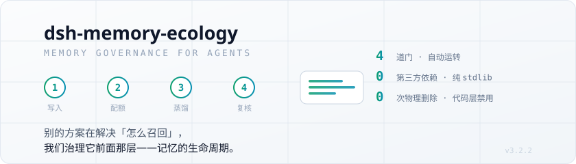

<div align="center">

<picture>
  <source media="(prefers-color-scheme: dark)" srcset=".github/assets/hero-dark.svg">
  <source media="(prefers-color-scheme: light)" srcset=".github/assets/hero-light.svg">
  
</picture>

[](VERSION.md) [](https://www.python.org/downloads/) [](#-30-秒上手) [](#-测试) [](#-两条硬纪律) [](#-兼容什么)

**给 agent 的记忆做「生命周期治理」：四道门自动运转，零第三方依赖，永不物理删除。**

</div>

agent 的记忆通常"只进不出、写入靠自觉、超限不可见"。
本项目不管「怎么召回」——那是检索层的事；它管**召回之前**：什么该进、进来放哪、什么时候忘、忘了能不能找回来。

---

## ⚡ 30 秒上手

不需要安装，纯 stdlib，克隆下来就能跑：

```bash
git clone https://github.com/Wind-Leaves-Echo-Guqin/dsh-memory-ecology && cd dsh-memory-ecology/core/src

python -m memory_ecology --root /tmp/eco-demo init
python -m memory_ecology --root /tmp/eco-demo deposit --session s1 --text "用户偏好中文回复"
python -m memory_ecology --root /tmp/eco-demo gate all      # 顺跑四门
python -m memory_ecology --root /tmp/eco-demo search "中文"  # 检索（命中回写 last_hit）
python -m memory_ecology --root /tmp/eco-demo catalog       # 看目录：注入上下文的就是它
```

每一步都是 JSON 进、JSON 出，退出码分档——便于任何宿主封装，也便于你自己接脚本。
跑完你会看到：条目进了 `detail/`，四门各跑了一遍，检索按词面命中。

<sub>想接宿主（dsh / Hermes）或装 GUI 观测舱，见 [🚀 完整上手](#-完整上手)。</sub>

---

## 🚪 四道门：它到底治理什么

记忆不是"存下来"就完事。它会腐烂、会重复、会互相打架、会超限。
四道门各管一件事，**自动运转、零维护**：

| 门 | 治理动作 | 不跑会怎样 |
|---|---|---|
| **① 写入整合** | 候选 → 去重 → 同源合并 → 类型归一 → 取代链 | 候选堆成山，同一件事存十份 |
| **② 配额巩固** | L2 → L1 提升；L1 超限 → 挤出回 L2（**绝不丢**） | L1 变成"只出不进"的单向漏斗 |
| **③ 画像蒸馏** | 跨会话稳定事实 → USER 画像（观察期 + 交叉印证） | 用户画像永远停在三个月前 |
| **④ 复核降级** | 遗忘曲线：active → dormant → archived（**文件一直在**） | 陈旧记忆腐烂，或最活跃的反被归档 |

四道门里，**只有门①的相似/矛盾终审和门③的措辞用到 LLM**，其余环节零 LLM、可完全离线。

### 两条硬纪律（机制保证，不是口头约定）

**1. 物理删除在代码层禁用。**
只有状态迁移（active→dormant→archived）、取代标记、隔离区移动。仓库里有一条测试
`test_no_unlink_of_memories_anywhere` 扫源码，发现 `unlink`/`remove` 记忆文件就红。

**2. 一个数据根只允许一个写者。**
并发只追加靠 pid 唯一临时名 + 单次 `O_APPEND` + SQLite WAL——三者缺一即丢写。

---

## 🆚 和别的记忆方案比，差别在哪

多数方案把力气花在**召回**（向量、重排、RAG）。召回做好了，记忆依然会：
过期的压着新的、矛盾的两条并存、超限后静默丢最新的。

本项目解决的是**召回之前**那层。诚实地说清楚边界：

| | 本项目 | 典型 RAG / 向量记忆 |
|---|---|---|
| 核心问题 | 记忆的**生命周期**（进/放/忘/找回） | 记忆的**检索质量** |
| 检索方式 | 词面 + 圈过滤（**召回质量不是卖点**） | 向量 / 混合检索 |
| 写入 | 规则判重 + 取代链 + 矛盾标记 | 通常直接 append |
| 超限 | 挤出到 L2 层，**绝不丢** | 截断或丢弃最旧 |
| 删除 | **代码层禁用**，只能降级 | 通常可删 |
| 依赖 | **0**（纯 stdlib） | 向量库 / embedding 模型 |
| 实测体量 | 核心 3,784 行 / 测试 3,626 行 | — |

> **什么场景下你不该选它**：如果你要的是"把十万篇文档塞进去做语义检索"，本项目帮不上
> 忙——它的检索只有词面匹配，`README` 里也明说"召回质量不是卖点"。它是给**单个 agent
> 的长期记忆**做治理的，不是通用检索引擎。

---

## 📦 仓库结构

从 `v3.2.2` 起是**两层并存**（`core/` 是唯一维护线，`src/` 是已冻结的历史线）：

| 目录 | 是什么 | 版本 |
|---|---|---|
| **`core/`** | **核心引擎（唯一维护线）**：四道门 + 多生态圈 + 只读记忆包 + 检索，纯 stdlib；dsh 插件本体 `core/plugin/` 也在这里 | **3.2.2** |
| `core/src/memory_ecology/` | 14 个模块：`gates.py` / `ledger.py` / `store.py` / `paths.py` / `retrieve.py` / `packs.py` / `config.py` / `root.py` / `similarity.py` / `measure.py` / `version.py` / `cli.py` / `__init__.py` / `__main__.py` | 3.2.2 |
| `core/tests/` | 核心 / 兼容与数据安全 / 并发 / 稳定性 / 变异（`run_tests.py` 7 组） | — |
| `src/memory_ecology/` | v3.1 治理核心（历史线，33 个 CLI 脚本 + 17 个测试）：写门/配额/蒸馏/复核/eco_note/向量缓存 | 3.1.0 |
| `integrations/hermes/` | Hermes 参考实现（state.db / cron 耦合件） | — |
| `integrations/dsh/` | dsh 适配器（`package/` = EAC；`package-cordis/` = 官方桌面版 cordis） | — |
| `integrations/gui-v3/` | 观测舱 GUI 当前发布版（液态玻璃 / iOS 外壳，七新视图） | 3.2.0 |
| `models/` | 本地 embedding 权重（按需 fetch，不入库） | — |
| `tools/` | 运维与回填工具（自检 / 看门狗 / 双树比对 / scope 回填） | — |

### 双树收敛计划（**不是"永久并存"**）

| 树 | 定位 | 现在能改吗 |
|---|---|---|
| **`core/`** | **唯一维护线**。新功能、缺陷修复只进这里 | ✅ 唯一入口 |
| `src/`（v3.1，33 脚本） | **已冻结**：只接受安全修复，不再加功能 | ⚠️ 冻结 |
| `integrations/hermes/` | 生产 cron 今天仍跑这一套（v3.1 脚本） | ⚠️ 冻结 |

- **冻结判据（可验证）**：`tools/sync_trees_check.py` 报双树漂移时，若改动只发生在 `src/`
  而 `core/` 无对应物，即视为冻结线被误改。
- **合并的唯一前置**：把生产 cron 从 v3.1 脚本切到 `core/`。在这一步完成前，合并两棵树
  都是不安全的（会连带改掉正在跑的运维件）。

> 两棵树为什么并存：`core/` 是重写版（14 模块），与 `src/` 下 v3.1（33 脚本）**实现完全
> 不同**，只有 `__init__.py` / `similarity.py` 同名。直接覆盖会毁掉 v3.1 那 33 个脚本以及
> 依赖它们的 `integrations/hermes` / `integrations/dsh`。

---

## 🚀 完整上手

### 1) 只用核心 CLI（任何宿主 / 无宿主）

```bash
cd core/src
python -m memory_ecology --root <数据根> init
python -m memory_ecology --root <数据根> deposit --session s1 --text "用户偏好中文回复"
python -m memory_ecology --root <数据根> gate all          # 顺跑四门
python -m memory_ecology --root <数据根> search "中文"      # 词面检索
python -m memory_ecology --root <数据根> catalog           # 目录载荷（注入用）
python -m memory_ecology --root <数据根> materialize       # 物化到 .eco/catalog/
python -m memory_ecology --root <数据根> health            # 健康快照（GUI 用）
python -m memory_ecology version                          # 版本四处对齐自检

cd .. && python run_tests.py                              # 全量测试（7 组）
```

### 2) dsh 宿主

```powershell
dsh plugin --profile <profile> add link:<本仓库>/core/plugin

# 可选：配数据根（不配就用 %LOCALAPPDATA%\dsh\memory-eco，首次自动建）
# ~/.dsh/profiles/<profile>/cordis.patch.yml:
#   - id: eco-memory
#     config:
#       rootPath: D:/work/_eco_root
#       catalogLimit: 20
#       catalogMaxChars: 600
```

配置全部可被同名环境变量覆盖：`ECO_HOME` / `ECO_CORE` / `ECO_PYTHON`。

### 3) Hermes 宿主

`integrations/hermes/` 是参考实现（state.db 会话增量提取 / pre_llm_call 报错注入 hook /
cron 健康告警 / 基因库快照），展示如何把核心接到"有会话库和调度器的宿主"上。
其他宿主照这个模式写适配器。

### 4) 观测舱 GUI（可选，人类宿主）

**当前发布版 = `integrations/gui-v3/`**（GUI 组件版本 **3.2.0**，液态玻璃 / iOS 外壳），
在原有九视图之外新增七个：四门实况 / 圈的视角 / 注入观测 / 记忆包 / 圈管理 / 成本面板 / 急救箱。

```bash
# gui-v3 是 vite 工程，dist 不入库，首次用需构建：
cd integrations/gui-v3 && npm install && npm run build

# 启动（默认 127.0.0.1:8788，自动开窗口）
python integrations/gui/eco_gui.py
# → 浏览器打开 http://127.0.0.1:8788/v3/
```

| 前端目录 | 路由 | 状态 |
|---|---|---|
| `integrations/gui-v3/` | `/v3/` | **当前发布版**（GUI 组件版本 **3.2.0**） |
| `integrations/gui/`（static） | `/`（v0.3 静态版） | 历史版本，保留 |
| `gui-v2` / `v2.1` / `v2.2` / `v2.3` | 各自路由 | 历史版本，不随发布物分发，按对应 tag checkout |

> **关于两套版本号**（新人最容易懵的一处）：本仓库有**两个互不相干的版本轴**——
> ① **产品/核心版本** = `3.2.2`（真源 `core/src/memory_ecology/__init__.py`）；
> ② **GUI 组件版本** = `3.2.0`（真源 `integrations/gui-v3/package.json`）。
> 它们刻意不对齐：GUI 是可选的人类观测界面，改动节奏与核心无关。
> README 里凡裸版本号若未带上下文，一律指①。

纯离线、仅绑 `127.0.0.1`；写动作共 **14 个**（配额挤出 / 写入门整合 / 经验采纳 / 技能繁育 /
cron 重跑 / cron 钉住 / 体检 / 索引重建 / 急救修复 / 圈配置 / 记忆包开 / 记忆包关 /
核心维护 / 物化），全部转发核心 CLI 并走确认闸门，**没有任何删除记忆的动作**。

---

## ⚠️ 当前边界与已知限制

写在前面，省得你试完才失望：

- **召回质量不是它的卖点**。检索是词面匹配 + 圈过滤，不做向量重排。要语义检索请自接。
- **四道门的门槛是保守值**，认的是"宁可重复，不可丢内容"。宁可多留条，不愿错删。
- **门④ 的"遗忘"是降级不是删除**：archived 条目文件一直在，可显式恢复。
- **GUI 是可选件**，核心不依赖它，没装 node 也能用全部治理能力。
- **只在 Windows 上做了真机验证**（生产环境是 Windows + 计划任务），Linux/macOS 未实测。
### ⚠️ 从旧版本升级时必读：第一次 `gate all` 会降级一批条目

**这不是数据丢失，但看起来像。**

门②③④ 在旧版本里因 phase 竞态**从未真正执行过**（详见 `core/CHANGELOG.md` H1 条）。
修好后第一次跑 `gate all`，会按遗忘曲线把久未使用的条目从 active 降为 dormant
（实测样本：**10 条里降 5 条**）。

这些条目**不再出现在注入目录**（目录只收 active），于是上下文里"突然少了一半记忆"。
但它们并没有被删除：

| 你想做什么 | 怎么做 |
|---|---|
| 确认条目还在 | `memory_query --revive`（无参数）列出今日复活候选 |
| 把它恢复回目录 | `memory_query --revive <slug>`（v3.1 线）<br>或 `python -m memory_ecology bring-back <id>`（`core/` 线） |
| 只是读正文 | `memory_query <关键词>` 仍能命中降级条目；`memory_load` 可读全文 |
| 想避免被降级 | 升级后先跑 `gate 4 --dry-run` 看会降哪些，确认后再真跑 |

> 两条线的恢复命令不同：**v3.1（生产当前在跑）= `memory_query --revive`**；
> **`core/`（新引擎）= `bring-back` 子命令**。别拿一条线的命令去另一条线上用。

---

## 🧩 兼容什么

| 消费者 | 怎么用 | 入口 |
|---|---|---|
| **任意 Python 程序** | `python -m memory_ecology` 子命令，JSON 进 JSON 出 | `core/src/` |
| **dsh**（DeepSeek Harness） | cordis 插件，只读 + fail-open，往 `pending/` 追加候选 | `integrations/dsh/package-cordis/` |
| **EAC / Extension SDK** | 同上，走 EAC 协议 | `integrations/dsh/package/` |
| **Hermes** | 参考实现：会话提取 + 注入 hook + cron | `integrations/hermes/` |
| **观测舱 GUI** | 人类用：本机浏览器 / pywebview 原生窗口，仅绑 127.0.0.1 | `integrations/gui-v3/` |

核心零改动即可接新宿主；接入步骤见 [integrations/dsh/README.md](integrations/dsh/README.md)。

---

## ✅ 测试

```bash
# 核心引擎（3.2.2，7 组全绿）
cd core && python run_tests.py

# v3.1 历史线（cwd=src/memory_ecology）
python test_eco_gates.py                # 四门持久化回归
python test_eco_note_error_query_v2.py  # 根因分层回归
python test_eco_version.py              # 健康行口径回归
python test_memory_query_time.py        # 时间维检索回归
python test_write_gate_conflict_tri.py  # 失效理由回归
python test_evidence_chain.py           # 证据链回归
python test_retrieval_report.py         # 零结果率观测回归
python test_vector_cache.py             # 向量缓存 shadow index 回归
python test_recall_rrf.py               # OR 召回 + RRF 融合回归
python test_concurrent_writes.py        # 并发写入
python test_safeio.py                   # 安全写路径回归
python test_similarity.py               # 相似度后端回归

# dsh 适配器（cwd=integrations/dsh）
node test_smoke.js    # EAC：注册面 / fail-open / 探针 reason 日志
node test_common.js   # 子进程语义
node test_cordis.mjs  # 官方桌面版：纯函数 + apply() 端到端
```

> 缺 python 或 zstandard 时测试会**显式失败**而不是静默跳过——它们是关键护栏。
> 变异测试组（`test_mutation.py`）专门验证"这些断言真的抓得住 bug"：把所有关键修复
> 逐个改回错误实现，看测试是否变红。

---

## 🧭 已知未完成项（如实登记）

> 债清单一向"让债可见"。以下几件事**有明确结论、只是还没做**，集中登记在此。

### 1. `src/` 与 `core/` 的合并 —— **现在不做，先对齐能力**

**结论**：不合并成"一棵树"，而是让 `core/` 吸收 `src/` 的缺口，齐平后直接删 `src/`。

**为什么不现在做**：两棵树差的是**能力面**，不是结构。`core/` 14 个模块 / 17 个子命令，
`src/` 33 个 CLI 脚本（另有 17 个测试）；`core/` 目前**没有** v3.1 的写入门（`write_gate`）、
golden 评测链路、`eco_health_check` 等。直接合并 = 功能回退。

**顺序（每步都可独立验证）**：
1. 让 A1 自检恢复可用 —— **已完成**（双布局探测 + 脱敏归一）；
2. 把 v3.1 独有能力逐个搬进 `core/`，每搬一个补对等测试；
3. 生产 cron 从 v3.1 脚本切到 `core/`，A1 连续通过一段时间；
4. 删除 `src/`。

### 2. `disputed_by` 的自动裁决 —— **不做全自动，改半自动**

**结论**：不做"LLM 自动判谁对谁错并删掉一条"。

**为什么**：`disputed_by` 的语义是"两条矛盾记忆并存"。让 LLM 自动裁决并删除，违背
两条硬纪律——"物理删除在代码层禁用"与"宁可重复，不可丢内容"。判错即**不可逆地丢失
用户记忆**。且实测生产库当前 **0 条 DISPUTE 标记**，无真实数据无法评估准确率。

**替代方案（待做）**：门③ 蒸馏时顺带为带 `disputed_by` 的条目产出**裁决建议**，写入
`pending/` 走既有的人工确认链路；`memory_query --disputes` 输出加一列建议。先把"建议"
跑准（可做影子比对），再谈放开自动。

### 3. v3.1 独立测试（`tests/`）尚未随发布物分发

**现状**：发布树只发 `tests/fixtures/`（论文复现依赖）。源树 `tests/` 下另有 27 个测试
（含 `test_v31_security` / `test_pii_rules` / `test_round3_redteam` 这批安全与隐私测试）
**没有随发**。

**为什么没做完**：这批测试依赖开发树的 `scripts/`、`tools/`、`agent-hooks/` 三处布局
（含 `subprocess` 里硬编码 `scripts/write_gate.py`、`ECO_SCRIPTS_DIR` 等）。实测：只补
`sys.path` 能到 201/222 通过，剩余 21 个缺 `eco_evolve` / `check_shell_sync` / `eco_extract`
等未登记件。

**为什么回退而不是硬发**：发一个"201/222 能跑"的测试目录，比不发更糟——会让人以为发布树
可回归。要么补齐到全绿，要么不发。

### 4. 门④ 的调度频率与"使用驱动"缺数据源（**生产侧，本仓库不含**）

- **门④ 一个月只跑一次**：生产 cron 表达式 `15 13 1 * *`（每月 1 号 13:15）。实测
  `review_log` 只有 2 行。也就是说"遗忘曲线"在**其余 30 天里完全不运转**。
- **"使用驱动免降级"缺数据源**：该机制依赖检索命中写 `hit` 表，但生产 `eco.db`
  **没有 `hit` 表**。缺这张表时"用过的不因日历超期被排水"实际**从未生效**。

**建议修法（未做）**：① 先确认 `hit` 表为何没建；② 把门④ 从"月跑"改成事件驱动或至少
每日；③ 再谈刷 `last_verified` 的上游改动——**顺序不能反**：数据源没有之前，刷戳逻辑
写了也跑不到。

### 5. 生态体检 cron 连续失败（Permission denied，**间歇性**）

生产「生态每日体检」曾 `failure_streak=5`，症状是写 `eco_score_history.json` 与
`生态体检报告.md` 时 `Permission denied`，但**报告内容其实生成成功**（stdout 兜底输出），
只是最后两个文件写不进去。

**已做诊断**：两个文件都不是只读、ACL 未拦；独占打开成功、父目录建临时文件成功；
**手动重跑同一脚本 exit 0**，两个文件均正常写入。

**结论：间歇性写冲突**，不是持续故障。对策（未做）：先观察下次成功后 `failure_streak`
是否归零；若高频复现，再给两个写入点加重试+退避（与 `lib/fs.py` 对 Windows `os.replace`
的既有处理同款），而不是去改权限。

### 6. A5 scope 覆盖未达标（缺 `scope` 键 + 回填工具不在生产）

生产自检 A5 报红：`detail 238 篇：新条目缺 scope 键 24（≥2026-10-25 部署线）；存量覆盖率
1%（回填目标 ≥70%）`。

**根因**：`tools/eco_backfill_scope.py` 只在本仓库，生产侧没有这个工具，回填从未在真实
数据上跑过。只读实测：`已有 scope 1 / 挤出跳过 58 / 指纹不可反推 31 / 待回填 148`。

**为什么暂缓（关键）**：生产 `detail` 里有 **3 条乱码重复条目**（如
`2026-10-08-1807-鍩庣幆26绾ц姳鍚嶅唽鏍搁獙-…` 是「城环26级花名册核验」的 GBK/UTF-8
混淆版），与正常中文命名条目**内容重复**。若现在回填，会把脏数据一并刷成有 scope，
等于把历史编码事故固化进数据面。

**稳妥顺序**：① 先处理那 3 条乱码重复条目；② 再跑 `--apply` 回填；③ 复跑 A5 确认。
在此之前 A5 保持红是**诚实状态**，不该为了让门禁变绿而回填脏数据。

---

## 📄 版本与历史

- 当前版本 **v3.2.2**——版本唯一真源：`core/src/memory_ecology/__init__.py::__version__`
  （核心四处：`__init__.py` / `pyproject.toml` / `plugin/package.json` / `VERSION.md`，
  `python -m memory_ecology version` 校验）。
- 版本要点：[VERSION.md](VERSION.md)；完整变更：[CHANGELOG.md](CHANGELOG.md)；
  架构待办与已知裂缝：[ARCHITECTURE_TODO.md](ARCHITECTURE_TODO.md)。
- 历史版本用 **git 历史 + 标签**管理：`git checkout <tag>` 或 Releases 页下载任意版本。

## 📄 License

MIT © 2026 Wind-Leaves-Echo-Guqin（沿用上游 memory-ecology 许可）
