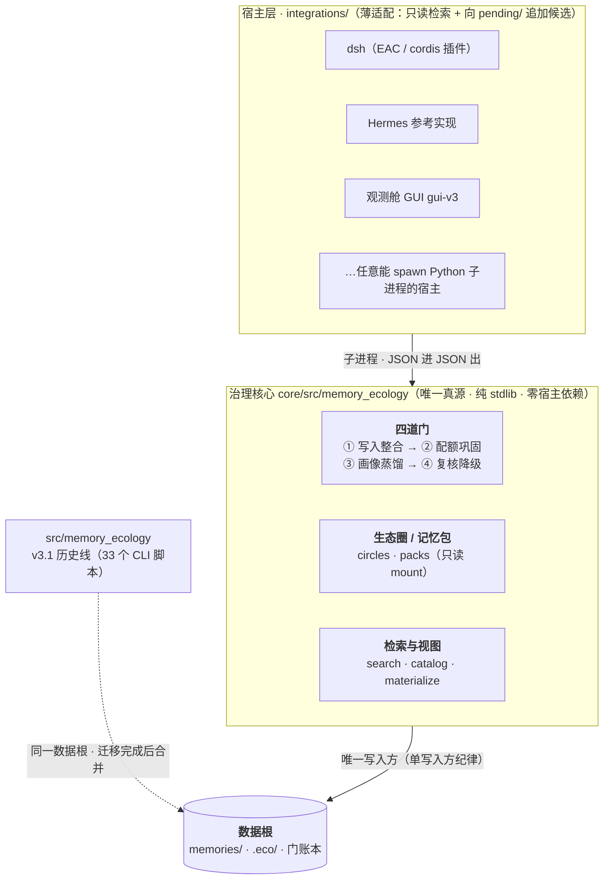

# 🧠 dsh-memory-ecology · 记忆生态

**让 agent 不再每次会话都失忆。**

[](VERSION.md)
[](https://www.python.org/downloads/)
[](#-完整上手)
[](#-当前边界与已知限制)
[](#-它是什么)
[](#-兼容什么)

> 多数记忆方案在解决「**怎么召回**」；
> 我们解决它前面那层——「**记忆的生命周期怎么治理**」。

源自 [memory-ecology](https://github.com/Wind-Leaves-Echo-Guqin/memory-ecology)（Hermes 版）。
本仓库把**可移植核心**与**宿主适配层**分离，让 Hermes 之外的 agent（当前：dsh）复用同一套记忆生命周期治理与经验笔记本。

---

## ⚡ 先跑起来（30 秒，纯 stdlib / 免安装）

```bash
git clone https://github.com/Wind-Leaves-Echo-Guqin/dsh-memory-ecology && cd dsh-memory-ecology/core/src
python -m memory_ecology --root /tmp/eco-demo init
python -m memory_ecology --root /tmp/eco-demo deposit --session s1 --text "用户偏好中文回复"
python -m memory_ecology --root /tmp/eco-demo gate all      # 顺跑四门
python -m memory_ecology --root /tmp/eco-demo search "中文"  # 检索（命中会回写 last_hit）
python -m memory_ecology --root /tmp/eco-demo catalog       # 看目录（注入上下文的就是它）
```

跑完就能看到：条目进了 `detail/`，四门跑过一遍，检索按词面命中。
**下面才是"它为什么这么设计"**——不读也能用，读了才知道边界在哪。
各宿主的完整接法见 [🚀 完整上手](#-完整上手)。

---

## 🎯 它是什么

把 agent 的记忆当成一个**生态系统**：有界、可逆、可追溯。

agent 的记忆通常"只进不出、写入靠自觉、超限不可见"。本生态用**四道门**治理记忆生命周期，
用**经验笔记本**沉淀"做事经验"（错误/成功/已验证链路）——规则驱动为主、可回滚：
四道门自动运转零维护，LLM 仅参与门①相似/矛盾终审与门③措辞，其余环节零 LLM、离线可用。

| 门 | 干什么 | 不跑会怎样 |
|---|---|---|
| **① 写入整合** | 候选 → 去重 → 同源合并 → 类型归一 → 取代链 | 候选堆成山、同一件事存十份 |
| **② 配额巩固** | L2 → L1 提升；L1 超限 → 挤出回 L2（**绝不丢**） | L1 变成"只出不进"的单向漏斗 |
| **③ 画像蒸馏** | 跨会话稳定事实 → USER 画像（观察期 / 交叉印证） | 用户画像永远停在三个月前 |
| **④ 复核降级** | 遗忘曲线：active → dormant → archived（**文件一直在**） | 陈旧记忆腐烂，或最活跃的反被归档 |

**两条硬纪律**（机制保证，不是约定）：

- **物理删除在代码层禁用**：只有状态迁移 + 取代标记 + 隔离区移动，`test_no_unlink_of_memories_anywhere` 扫描源码。
- **唯一写者**：一个数据根只允许一个执行方跑门；并发只追加靠 pid 唯一临时名 + 单次 `O_APPEND` + SQLite WAL（三者缺一即丢写）。

系统由两条设计哲学不同的线构成（此前统称"四道门+经验笔记本"，易误读为同质系统）：

| | 自动治理线（四道门） | 半自动沉淀线（经验笔记本） |
|---|---|---|
| 目标 | 自动化运转（提升/挤出/蒸馏/复核） | 低置信度标记 + 人工兜底 |
| 追求 | 可逆、幂等、稳态（防震荡） | 可观测、可追溯、零误伤 |
| 边界 | 只出合并/复活**候选**，不自动裁决 | signals/merge/gold 均只标记不判定 |

**定位澄清**：`eco_health_check.py` 检查的是 skills/ 生态（frontmatter 合法性、引用图、cron 健康），
**不是**四道门的运行状态仪表盘；门级运行状态看 `core/` 的账本（`eco health`）与各门日志。
`memory_query.py` 是记忆（detail+archive）的检索入口。

---

## 🔀 为什么不一样

多数记忆方案回答的核心问题是「**怎么召回**」（embedding → 向量库 → 检索拼接）；本项目的重心在它
前面的一层：「**记忆的生命周期怎么治理**」——写入、合并、挤出、蒸馏、遗忘、复核，检索只是治理
结果的消费端。

| 维度 | 典型向量 RAG 记忆 | 本项目 |
|---|---|---|
| 增长模型 | 只进不出，越攒越脏 | 配额恒有界（门②）+ 遗忘曲线（门④） |
| 事实冲突 | 新旧并存，召回看运气 | 矛盾失效 superseded → 隔离区，历史可追溯 |
| 删除 | 物理删除或放任 | 代码层禁用物理删除，一切状态转换可逆 |
| 做事经验 | 与事实混在同一库 | 独立经验笔记本：按需检索、只标记不判定、人工兜底后技能化 |
| 依赖 | 通常绑定 embedding 服务 | 规则优先、离线可用；LLM 仅门①终审与门③措辞 |
| 宿主 | 单应用视角 | 共享数据根 + 单写入方纪律，多宿主并存 |

> 简化对比，仅供定位：各家方案均在演进，以官方文档为准。另注意本项目的检索当前为词面级
> （见「⚠️ 当前边界与已知限制」），召回质量不是它的卖点——生命周期治理才是。

---

## 🏗 架构总览



- **宿主只做两件事**：spawn 子进程调检索 CLI、向 `pending/` 追加候选——记忆的读写大权只在治理核心手里。
- **插件与核心只有一条通道**：一次子进程、JSON 进 JSON 出。插件里不许出现领域规则，核心里不许出现宿主概念。
- **多宿主并存**：不同宿主把数据根指向同一处即可共享记忆与经验。

---

## 🚀 完整上手

### 1) 只用核心 CLI（任何宿主/无宿主）

```bash
cd core/src            # 免安装直接跑（也可 pip install -e core 后在任何目录用）
python -m memory_ecology --root <数据根> init
python -m memory_ecology --root <数据根> deposit --session s1 --text "用户偏好中文回复"
python -m memory_ecology --root <数据根> gate all        # 顺跑四门
python -m memory_ecology --root <数据根> search "中文"    # 词面检索
python -m memory_ecology --root <数据根> materialize     # 物化目录视图到 .eco/catalog/
python -m memory_ecology --root <数据根> health          # 健康快照（GUI 用）
python -m memory_ecology version                        # 版本四处对齐自检

cd .. && python run_tests.py                            # 全量测试（7 组）
```

核心是纯 stdlib、零第三方依赖；每个子命令 JSON 进、JSON 出，退出码分档，便于任何宿主封装。

### 2) dsh 宿主

```powershell
dsh plugin --profile <profile> add link:<本仓库>/core/plugin

# 可选：配数据根（不配就用 %LOCALAPPDATA%\dsh\memory-eco，首次自动建）
# ~/.dsh/profiles/<profile>/cordis.patch.yml:
#   - id: eco-memory
#     config:
#       rootPath: D:/work/_eco_root
#       catalogLimit: 20
#       catalogMaxChars: 600
```

配置全部可被同名环境变量覆盖：`ECO_HOME` / `ECO_CORE` / `ECO_PYTHON`。

### 3) Hermes 宿主

`integrations/hermes/` 为参考实现（state.db 会话增量提取 / pre_llm_call 报错注入 hook / cron 健康告警 /
基因库快照），展示如何把核心接到"有会话库和调度器的宿主"上。其他宿主照此模式写适配器。

### 4) 观测舱 GUI（可选，人类宿主）

**当前发布版 = `integrations/gui-v3/`（v3.2.0，液态玻璃 / iOS 外壳）**，
在原有九视图之外新增七个：四门实况 / 圈的视角 / 注入观测 / 记忆包 / 圈管理 / 成本面板 / 急救箱。

```bash
# gui-v3 是 vite 工程，dist 不入库，首次用需构建：
cd integrations/gui-v3 && npm install && npm run build

# 启动（默认 127.0.0.1:8788，自动开窗口）
python integrations/gui/eco_gui.py
# → 浏览器打开 http://127.0.0.1:8788/v3/   （/ 也指到 v3）
# 也可双击 integrations/gui/启动生态观测舱v3.2.0.pyw（pythonw 直启，无控制台黑框）
# 服务异常自救：双击 integrations/gui/生态急救箱.cmd（自检→修复→重启→开窗）
```

| 前端目录 | 路由 | 状态 |
|---|---|---|
| `integrations/gui-v3/` | `/v3/` | **当前发布版**（GUI 组件版本 **3.2.0**） |
| `integrations/gui/`（static） | `/`（v0.3 静态版） | 历史版本，保留 |
| `gui-v2` / `v2.1` / `v2.2` / `v2.3` | 各自路由 | 历史版本，不随发布物分发，按对应 tag checkout |

> **关于两套版本号**（新人最容易懵的一处）：本仓库有**两个互不相干的版本轴**——
> ① **产品/核心版本** = `3.2.2`（真源 `core/src/memory_ecology/__init__.py`）；
> ② **GUI 组件版本** = `3.2.0`（真源 `integrations/gui-v3/package.json`）。
> 它们刻意不对齐：GUI 是可选的人类观测界面，改动节奏与核心无关。
> README 里凡是裸版本号若未带上下文，一律指①。

纯离线、仅绑 `127.0.0.1`；写动作共 **14 个**（配额挤出 / 写入门整合 / 经验采纳 / 技能繁育 /
cron 重跑 / cron 钉住 / 体检 / 索引重建 / 急救修复 / 圈配置 / 记忆包开 / 记忆包关 /
核心维护 / 物化），
全部转发核心 CLI 并走确认闸门，**没有任何删除记忆的动作**。
Hermes 专属动作（cron 重跑等）在未安装 Hermes 的机器上降级为"可复制命令"。

---

## 📦 仓库结构

**v3.2.2 起两层并存**（`core/` 是唯一真源，`src/` 是历史线，**已冻结**，见下方"双树收敛计划"）：

| 目录 | 是什么 | 版本 |
|---|---|---|
| **`core/`** | **核心引擎（唯一真源）**：四道门 + 多生态圈 + 只读记忆包 + 检索，纯 stdlib；dsh 插件本体 `core/plugin/` 也在这里 | **3.2.2** |
| `core/src/memory_ecology/` | 14 个模块：`gates.py` / `ledger.py` / `store.py` / `paths.py` / `retrieve.py` / `packs.py` / `config.py` / `root.py` / `similarity.py` / `measure.py` / `version.py` / `cli.py` | 3.2.2 |
| `core/tests/` | 核心 / 兼容与数据安全 / 并发 / 稳定性 / 变异（`run_tests.py` 7 组） | — |
| `core/docs/` | `ARCHITECTURE.md`（含 7 blocker + 11 major 缺陷清单）、`OPS.md`（零运维手册） | — |
| `src/memory_ecology/` | v3.1 治理核心（历史线，33 个 CLI 脚本 + 17 个测试）：写门/配额/蒸馏/复核/eco_note/向量缓存 | 3.1.0 |
| `integrations/hermes/` | Hermes 参考实现（state.db / cron 耦合件） | — |
| `integrations/dsh/` | dsh 适配器（`package/`＝EAC；`package-cordis/`＝官方桌面版 cordis） | — |
| `integrations/gui-v3/` | 观测舱当前发布版（液态玻璃 / iOS 外壳，七新视图） | 3.2.0 |
| `integrations/gui/` | 观测舱服务端（8788）+ v0.3 静态前端（历史） | — |
| `models/` | 本地 embedding 权重（bge-small/base/large-zh-v1.5 + text2vec；按需 fetch，不入库） | — |
| `tools/` | `sync_trees_check.py`（双树漂移比对） | — |

> **为什么要两层**：`core/` 是重写版（14 个模块，`gates.py`/`ledger.py`/`packs.py`），
> 与 `src/` 下的 v3.1（33 个脚本，`write_gate.py`/`eco_quota.py`）**实现完全不同**，
> 只有 `__init__.py` / `similarity.py` 同名。直接覆盖会毁掉 v3.1 的 33 个脚本以及依赖它们的
> `integrations/hermes` / `integrations/dsh`，所以并存而非替换。

### 双树收敛计划（**不是"永久并存"**）

上面那段是**历史原因**，不是计划。真正的计划如下——写清楚是为了让读者不必猜：

| 树 | 定位 | 现在能改吗 |
|---|---|---|
| **`core/`** | **唯一维护线**。所有新功能、缺陷修复只进这里 | ✅ 唯一入口 |
| `src/`（v3.1，50 脚本） | **已冻结**：只接受安全修复，不再加功能 | ⚠️ 冻结 |
| `integrations/hermes/` | 生产 cron 今天仍跑这一套（**v3.1 脚本**） | ⚠️ 冻结 |

- **冻结判据（可验证）**：`tools/sync_trees_check.py` 报"双树漂移"时，若改动只发生在
  `src/` 而 `core/` 无对应物，即视为**冻结线被误改**，需要解释。
- **合并的唯一前置**：把生产 cron 从 v3.1 脚本切到 `core/`。**在这一步完成前，
  合并两棵树都是不安全的**（会连带改掉正在跑的运维件）。
- **截止承诺**：v3.1 线不再接受新功能（自本版本起即生效）；`src/` 的归档时间
  取决于生产者切换，**不设虚假日期**——但切换完成当版本即删 `src/`。
  <br>（此前版本 README 只写"迁移完成后再合并"，没有约束力，这是它的缺陷。）

---

## ⚠️ 当前边界与已知限制

诚实边界，先读再用。

> [!IMPORTANT]
> **① 检索是词面级的，不是语义检索。** 默认后端 difflib（字符级子串 + 词面打分），召回依赖关键词选择。

已有的补强路（均**默认关闭**、可在线观测后再决定默认化）：

- **时间维**：三档半连续衰减 + `--since/--until/--window` 发生时间过滤；零结果率观测（`eco_retrieval_report.py` / GUI「检索质量」页签）。
- **OR 召回兜底**：`--recall` 任一 term 命中即召回，RRF 融合排序（补多词 AND 的召回缺口）。
- **向量检索路**：`--semantic` 本地向量缓存 shadow index（余弦排序；缓存可丢弃，源真源仍是 Markdown）。
- **本地 embedding**（`bge-small-zh-v1.5` + CLS pooling，golden 182 对 AUC 0.93 vs difflib 0.90）为
  **可选后端，尚未默认启用**——选型依据与启用方式见 [models/README.md](models/README.md)、
  `src/memory_ecology/lib/similarity.py` 与 [ARCHITECTURE_TODO.md](ARCHITECTURE_TODO.md) §三。

> [!NOTE]
> **② 经验笔记本是半自动线**：signals/merge/gold 只标记不判定，成熟/合并需人工兜底
> （见「🎯 它是什么」的两条纪律线对照）。

> [!WARNING]
> **③ Status: 🚧 Work in Progress**（2026-10-04 全量审计后进入收敛期）。
> 已知问题与架构待办见 [ARCHITECTURE_TODO.md](ARCHITECTURE_TODO.md)；`core/` 的缺陷清单见
> `core/docs/ARCHITECTURE.md` §11。

---

## 🧩 兼容什么

「兼容」的不是某一个产品，而是「任何 agent 宿主」——三层含义：

| 层 | 兼容对象 | 说明 |
|---|---|---|
| **可移植核心** | 任意能 spawn Python 子进程的宿主 | `core/src/memory_ecology`（四道门 + 生态圈 + 记忆包）零宿主依赖，CLI / 脚本 / MCP 封装均可直接调用；`src/memory_ecology`（v3.1）继续可用 |
| **Hermes 适配层** | 上游 [memory-ecology](https://github.com/Wind-Leaves-Echo-Guqin/memory-ecology) 的宿主（参考实现全套） | `integrations/hermes/`：state.db 会话增量提取、pre_llm_call 报错注入 hook、cron 健康告警、基因库快照 |
| **dsh 适配层** | dsh 双插件体系 | `integrations/dsh/`：`package/`＝EAC 变体（Extension SDK `provideContext`/`registerTool`）；`package-cordis/`＝官方桌面版（cordis patch 层 `agent/pre-step` 注入 + `ctx.tools.register`）——均只读 + fail-open |
| **观测舱 GUI** | 人类（本机浏览器 / pywebview 原生窗口） | `integrations/gui-v3/`：本地可视化驾驶舱（只读观测 + 走确认闸门的写操作），仅绑 127.0.0.1 |
| **共享数据根** | 多宿主并存 | 多宿主指向同一数据根即可共享记忆与经验；**单写入方纪律**保证四道门只有一个调度器 |

**适配新宿主**：照 `integrations/` 现有模式写薄壳（每回合 hook → subprocess 调检索 CLI → 拼注入文本），
核心零改动；接入步骤见 [integrations/dsh/README.md](integrations/dsh/README.md)。

---

## ✅ 测试

```bash
# 核心引擎（3.2.2，7 组全绿）
cd core && python run_tests.py

# v3.1 历史线（cwd=src/memory_ecology）
python test_eco_gates.py              # 四门持久化回归
python test_eco_note_error_query_v2.py  # 根因分层回归
python test_eco_version.py            # 健康行口径回归
python test_memory_query_time.py      # S1 时间维检索回归
python test_write_gate_conflict_tri.py  # S2 失效理由回归
python test_evidence_chain.py         # S3 证据链回归
python test_retrieval_report.py       # S4 零结果率观测回归
python test_vector_cache.py           # S6 向量缓存 shadow index 回归
python test_recall_rrf.py             # S7 OR 召回 + RRF 融合回归
python test_concurrent_writes.py      # 并发写入（同门/跨门/stale 锁/原子写可见性/同进程重入）
python test_safeio.py                 # 安全写路径回归
python test_similarity.py             # 相似度后端回归

# dsh 适配器（cwd=integrations/dsh）
node test_smoke.js                    # EAC：注册面 / fail-open / 探针 reason 日志
node test_common.js                   # 子进程语义（退出码分档 / `--` 分隔 / 解释器绝对路径 / 最小环境）
node test_cordis.mjs                  # 官方桌面版：纯函数 + apply() 端到端（假宿主包 + 桩 Python）
```

> 以上测试缺 python 或 zstandard 时会**显式失败**而不是静默跳过——它们是关键护栏。

---

## 📄 版本与历史

- 当前版本 **v3.2.2**——版本唯一真源：`core/src/memory_ecology/__init__.py::__version__`
  （核心四处：`__init__.py` / `pyproject.toml` / `plugin/package.json` / `VERSION.md`，`python -m memory_ecology version` 校验）。
- 版本要点：[VERSION.md](VERSION.md)（核心层另有 `core/VERSION.md`，两处需同步）；完整变更：[CHANGELOG.md](CHANGELOG.md)。
- 历史版本用 **git 历史 + 标签**管理：`git checkout <tag>` 或 Releases 页下载任意版本。

---

## 🧭 已知未完成项（如实登记，不是路线图口号）

> 这一节存在的理由：本项目的债清单（[ARCHITECTURE_TODO.md](ARCHITECTURE_TODO.md)）一向"让债可见"，
> 但有几件事**有明确结论、只是还没做**，散落在各处容易忘。集中登记在此。

### 1. `src/` 与 `core/` 的合并 —— **现在不做，先对齐能力**

**结论**：不合并成"一棵树"，而是让 `core/` 吸收 `src/` 的缺口，齐平后直接删 `src/`。

**为什么不现在做**：两棵树差的是**能力面**，不是结构。`core/` 14 个模块 / 17 个子命令，
`src/` 33 个 CLI 脚本（另有 17 个测试）；`core/` 目前**没有** v3.1 的写入门（`write_gate`）、
golden 评测链路、`eco_health_check` 等。直接合并 = 功能回退。

**顺序（每步都可独立验证）**：
1. 让 A1 自检恢复可用 —— **已完成**（双布局探测 + 脱敏归一，见下节"最近的修复"）；
2. 把 v3.1 独有能力逐个搬进 `core/`，每搬一个补对等测试；
3. 生产 cron 从 v3.1 脚本切到 `core/`，A1 连续通过一段时间；
4. 删除 `src/`。

**阻塞点**：第 2 步是主要工作量；第 3 步需要人工决策（生产切换有风险）。

### 2. `disputed_by` 的自动裁决 —— **不做全自动，改半自动**

**结论**：不做"LLM 自动判谁对谁错并删掉一条"。

**为什么**：`disputed_by` 的语义是"两条矛盾记忆并存"。让 LLM 自动裁决并删除，
违背本项目两条硬纪律——"物理删除在代码层禁用"与"宁可重复，不可丢内容"。
判错即**不可逆地丢失用户记忆**。且实测生产库当前 **0 条 DISPUTE 标记**，
在无真实数据的情况下做裁决无法评估准确率。

**替代方案（待做）**：门③ 蒸馏时顺带为带 `disputed_by` 的条目产出**裁决建议**，
写入 `pending/` 走既有的人工确认链路；`memory_query --disputes` 输出加一列建议。
先把"建议"跑准（可做影子比对），再谈放开自动。

### 3. v3.1 独立测试（`tests/`）尚未随发布物分发

**现状**：发布树只发 `tests/fixtures/`（论文复现依赖）。源树 `tests/` 下另有
27 个测试（含 `test_v31_security` / `test_pii_rules` / `test_round3_redteam` 这批
安全与隐私测试）**没有随发**。

**为什么没做完**：这批测试依赖开发树的 `scripts/`、`tools/`、`agent-hooks/` 三处布局
（含 `subprocess` 里硬编码 `scripts/write_gate.py`、`ECO_SCRIPTS_DIR` 等），
发布树布局不同。当晚实测：只补 `sys.path` 能到 201/222 通过，剩余 21 个缺
`eco_evolve` / `check_shell_sync` / `eco_extract` 等未登记件。

**为什么回退而不是硬发**：发一个"201/222 能跑"的测试目录，比不发更糟——
会让人以为发布树可回归。要么补齐到全绿，要么不发。

**要做的话**：给发布树加 `scripts` → `src/memory_ecology` 的布局兼容（实测软链可让
201 通过），再补齐 `tools/` 与 `agent-hooks/` 的依赖件，最后要求 `pytest tests` 全绿。

### 4. 门④ 的调度频率与"使用驱动"缺数据源（**生产侧，本仓库不含**）

这一条是 2026-10-30 排查生产环境时发现的，**属部署运维范畴，不在本仓库代码里**，
但因为它直接影响"四道门"对外承诺的可信度，如实登记：

- **门④ 一个月只跑一次**：生产 cron 表达式 `15 13 1 * *`（每月 1 号 13:15）。
  实测 `review_log` 只有 2 行，最后一条来自 2026-10-01。也就是说"遗忘曲线"
  在**其余 30 天里完全不运转**——陈旧记忆不会被降级，直到下个月 1 号。
- **"使用驱动免降级"缺数据源**：该机制依赖检索命中写 `hit` 表，但生产 `eco.db`
  **根本没有 `hit` 表**。缺这张表时 `use_note` 永远为空，"用过的不因日历超期被排水"
  这条承诺实际**从未生效**，只剩"日历超期"一条腿。
- **实测影响面（当前很小）**：238 条 detail 里，`last_hit` 比 `last_verified` 新的仅
  1 条，且未超期；濒临降级 0 条。所以**暂无损害**，但机制是断的。

**建议的修法（未做）**：① 先确认 `hit` 表为何没建（`memory_query` 的写命中路径是否
从未被触发）；② 把门④ 从"月跑"改成"事件驱动"（每次会话/维护都跑）或至少每日；
③ 再谈刷 `last_verified` 的上游改动——**顺序不能反**：数据源没有之前，刷戳逻辑
写了也跑不到。

## 📄 License

MIT © 2026 Wind-Leaves-Echo-Guqin（沿用上游 memory-ecology 许可）
